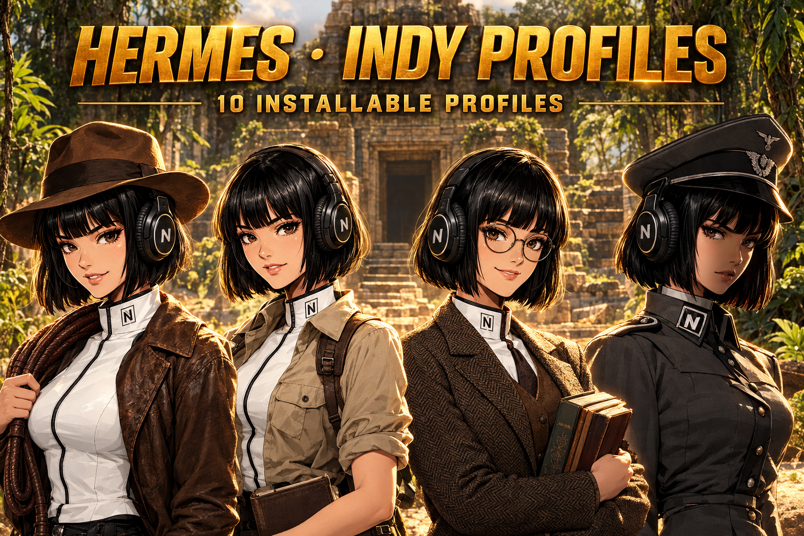

# Hermes Indy Profiles



Installable Hermes Agent personas inspired by the Indy universe (famous, most-popular cast).

Each persona is a separate Hermes [profile distribution](https://hermes-agent.nousresearch.com/docs/user-guide/profile-distributions).
It changes how the agent reasons, communicates, disagrees, and handles pressure — not a quote engine, and never a tool-setback.

> **Unofficial, non-commercial fan work.** Not affiliated with or endorsed by any rights holder. See [RIGHTS.md](./RIGHTS.md).

## Roster (20 profiles)

**The Explorers (7):** Indiana Jones, Marion Ravenwood, Helena Shaw, Mutt Williams, Short Round, Willy Scott, Henry Jones Sr
**Allies & Archivists (5):** Marcus Brody, Sallah, Abner Ravenwood, Pam Bouvier, Wendy Callahan
**The Adversaries (6):** Rene Belloq, Dr Ernst Vogel, Jurgen Voller, Elsa Schneider, Walter Donovan, Colonel Dietrich
**The Young Chronicles (2):** Young Indiana Jones, Ernest Hemingway

## Install

```bash
git clone https://github.com/JPeetz/hermes-indiana-jones-profiles.git
cd hermes-indiana-jones-profiles
hermes profile install ./profiles/<slug>
```
Start: `<slug> chat` or `hermes -p <slug> chat`.

## Build & verify

```bash
python3 tools/fabricate.py           # regenerate profiles/ + catalog.json from source/
python3 tools/verify.py              # structural + banned-token gate
```
Sources: `source/*.json` (21-key persona schema) + `source/franchise.yaml`.

## Rights & attribution

Unofficial fan work. Lucasfilm / The Walt Disney Company. Full statement in [RIGHTS.md](./RIGHTS.md). The profile-distribution pattern is
inspired by [teknium1/hermes-star-trek-profiles](https://github.com/teknium1/hermes-star-trek-profiles).

---

### ☕ Support this work
If these profiles save you time, consider buying me a coffee:
<a href="https://www.buymeacoffee.com/joerg_peetz"></a>

**Stay building. — JPeetz**
